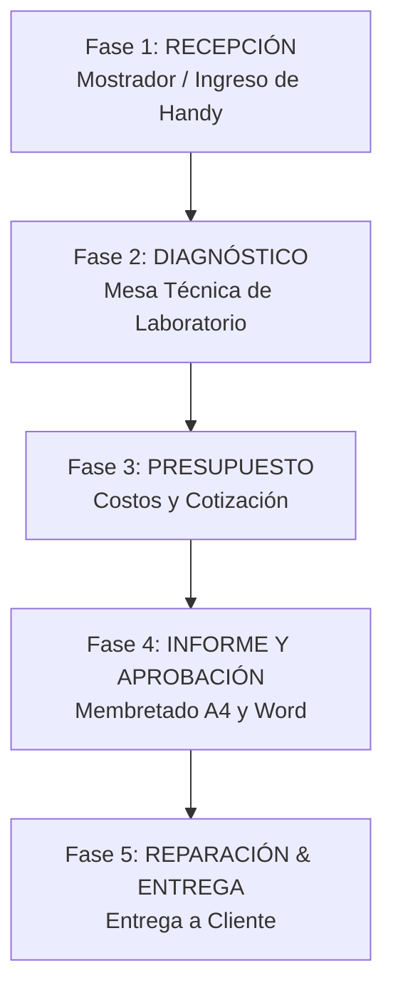

# PROJECT HANDOVER & GUÍA DE CONTINUIDAD — AMERICASIS ERP

> **Documento de migración de contexto para nuevos chats, agentes de IA y desarrolladores.**  
> **Proyecto:** Sistema de Gestión y Reparación de Radiocomunicaciones — AMÉRICA SRL  
> **Producción:** `americasis.cmoop.com`  
> **Rama activa de despliegue:** `docker-deploy`  
> **Fecha de actualización:** Octubre 2026  

---

## 1. Visión General del Proyecto

**AMERICASIS** es un sistema web ERP especializado para talleres de servicio técnico y radiocomunicaciones (equipos Motorola, Hytera, Kenwood, etc.). Gestiona el ciclo completo de una orden de servicio: desde la recepción del equipo en mostrador, pasando por la mesa técnica de diagnóstico de placa, cotización de repuestos, generación de informes técnicos oficiales membretados en formato A4 y Word `.docx`, hasta la entrega al cliente.

### Stack Tecnológico:
- **Framework Web:** Next.js 16.3.8 (App Router, Node.js 24+)
- **Frontend:** React 19, Lucide React (iconos), Vanilla CSS + utilidades Tailwind
- **Base de Datos & Auth:** Supabase Cloud (PostgreSQL 15, Auth, Storage bucket `evidencias-radios`)
- **Fallback DB:** PostgreSQL Pool directo (`pg`)
- **Procesamiento de Imágenes:** Canvas API en navegador (`image/webp`, max 1280px, < 200 KB)
- **Generación de Documentos:** `docx` para exportación milimétrica a Microsoft Word
- **Contenedores:** Docker & Docker Compose en producción

---

## 2. Arquitectura y Estructura del Código

```text
sistema_america/
├── src/
│   ├── app/
│   │   ├── (roles)/                     # Vistas organizadas por perfil de usuario
│   │   │   ├── recepcion/               # Rol RECEPCION y ADMINISTRADOR
│   │   │   │   ├── inicio/              # Tablero principal de mostrador
│   │   │   │   ├── nueva-orden/         # Formulario de ingreso (Fase 1)
│   │   │   │   ├── orden/[id]/
│   │   │   │   │   ├── recepcion/       # Edición de datos de recepción y fotos
│   │   │   │   │   ├── presupuesto/     # Fase 3: Edición de cotización
│   │   │   │   │   └── informe/         # Fase 4: Vista previa A4 e informe
│   │   │   │   └── historial/           # Historial de órdenes de mostrador
│   │   │   ├── tecnico/                 # Rol TECNICO
│   │   │   │   ├── inicio/              # Cola de mesa técnica y órdenes asignadas
│   │   │   │   ├── diagnostico/[ordenId]# Fase 2: Mesa de Diagnóstico de Laboratorio
│   │   │   │   └── historial-personal/  # Trabajos realizados por el técnico
│   │   │   ├── admin/                   # Rol ADMINISTRADOR
│   │   │   │   ├── inicio/              # KPIs y control gerencial
│   │   │   │   ├── personal/            # Gestión de técnicos y usuarios
│   │   │   │   └── historial/           # Historial global
│   │   │   └── movil/
│   │   │       ├── evidencias/[ordenId]/[equipoId]/ # Captura de fotos vía celular (QR)
│   │   │       └── escaner/[sessionId]/             # Escaneo de códigos de barra
│   │   ├── api/                         # Endpoints REST (Route Handlers)
│   │   │   ├── auth/                    # login, logout, me, change-password
│   │   │   ├── orders/                  # CRUD de órdenes y persistencia general
│   │   │   │   ├── [id]/                # PUT (diagnóstico, recepción, general), DELETE
│   │   │   │   └── [id]/diagnosis/      # Endpoints específicos de diagnóstico
│   │   │   ├── evidences/               # Subida directa y gestión de fotos
│   │   │   ├── catalogs/                # Fallas (faults) y repuestos (accessories)
│   │   │   └── users/                   # Lista y asignación de usuarios
│   ├── components/
│   │   ├── orders/                      # Componentes de las 4 fases de trabajo
│   │   │   ├── Step1Reception.jsx       # Fase 1: Formulario de mostrador y accesorios
│   │   │   ├── Step2Diagnosis.jsx       # Fase 2: Mesa técnica (Fallas, repuestos, fotos)
│   │   │   ├── Step3Budget.jsx          # Fase 3: Cálculo comercial y moneda
│   │   │   ├── Step4ReportPreview.jsx   # Fase 4: Hoja A4 membretada y anexo fotográfico
│   │   │   ├── EquipmentTabs.jsx        # Pestañas para órdenes con múltiples radios
│   │   │   └── OrderPhaseNav.jsx        # Barra superior de navegación entre fases
│   │   └── modals/
│   │       ├── QrMobileModal.jsx        # Generador de QR para vincular cámara del celular
│   │       └── ImageCropModal.jsx       # Recorte y rotación estilo WhatsApp
│   ├── lib/
│   │   ├── services/
│   │   │   ├── orders.service.js        # Servicio unificado frontend (localStorage + API)
│   │   │   └── users.service.js         # Autenticación y técnicos locales
│   │   ├── utils/
│   │   │   ├── imageCompressor.js       # Compresión Canvas WebP y subida a Supabase
│   │   │   ├── docxExport.js            # Exportación oficial a Word .docx
│   │   │   └── currencyFormat.js        # Formatos BOB / USD y literal
│   │   └── config/
│   │       ├── supabase-client.js       # Cliente frontend Supabase
│   │       └── database.js              # Pool PostgreSQL backend
│   └── modules/orders/                  # Capa de negocio backend
│       ├── orders.service.js            # Lógica y auditorías
│       └── orders.repository.js         # Transacciones SQL y sincronización Supabase
```

---

## 3. Flujo de Trabajo del Taller (Las 5 Fases Oficiales)



### Fase 1: Recepción en Mostrador (`/recepcion/nueva-orden` o `/recepcion/orden/[id]/recepcion`)
- **Datos del Cliente:** Razón Social, NIT/CI, Teléfono, Persona de Contacto.
- **Lote de Equipos:** Registro de uno o múltiples handys (Marca, Modelo, Número de Serie, Banda VHF/UHF).
- **Checklist de 10 Accesorios Estándar:** Antena, Batería, Cargador, Clip, Micrófono externo, Adaptador, Base de cargador, Micrófono de radio, Cable de alimentación, Fuente de poder. Cada uno con estado `CON` / `SIN` y capacidad de batería.
- **Falla Declarada:** Descripción del problema según el cliente.
- **Fotos de Ingreso (Exteriores):** Fotos del estado físico de recepción etiquetadas con `etapa: 'RECEPCION'`.

### Fase 2: Mesa de Diagnóstico del Técnico (`/tecnico/diagnostico/[ordenId]`)
- **Acceso Directo:** Botón verde `[ Tomar y Diagnosticar ]` en `/tecnico/inicio`. Asigna al técnico en sesión de inmediato sin bloqueos ni aprobaciones burocráticas (`OrdersService.tomarYDiagnosticar`).
- **Sección de Consulta: Evidencias de Recepción (Estado Inicial) [Modo Lectura]:**
  - Muestra miniaturas de las fotos tomadas en mostrador.
  - Al hacer clic en cualquier foto, abre el **Lightbox Modal** en alta resolución con zoom interactivo (`1x`, `1.5x`, `2x`), botón de descarga y cierre con tecla `Esc`.
  - Permiso exclusivo de visualización (sin botón de eliminación).
  - Si no hay fotos, muestra: *"Sin fotos de ingreso registradas en mostrador"*.
- **Evaluación de Accesorios y Batería:**
  - Botones de condición: `Operativa`, `Dañado/Roto`, `Se sugiere reemplazo`.
  - Medidor de batería con selector rápido (`100%`, `80%`, `50%`, `20%`, `0%` o porcentaje manual) con alertas visuales por color.
- **Chequeo de Fallas de Placa Electrónica:**
  - Catálogo filtrado por categoría (`TX`, `RX`, `AUDIO`, `ALIMENTACION`, `LOGICA`, `CHASIS`).
  - Buscador en tiempo real y opción de agregar fallas personalizadas.
  - Generación automática instantánea del texto técnico formal con base en fallas y repuestos seleccionados.
- **Fotografías de Daños y Estado Interno (Técnico) [Modo Edición]:**
  - Tres vías de captura:
    1. `[ Tomar con Cámara ]`: Captura directa mediante la cámara del dispositivo móvil o tablet.
    2. `[ Vincular Celular (QR) ]`: Abre `QrMobileModal` para sincronizar en tiempo real fotos tomadas desde un smartphone mediante WebSockets / Realtime (`onImagesUpdated`).
    3. `[ Subir desde PC / Archivos ]`: Explorador de archivos con compresión por lotes.
  - **Compresión Canvas Obligatoria:** Todas las fotos pasan por `imageCompressor.js` (`image/webp`, máx 1280px, peso < 200 KB).
  - Miniaturas con apertura a Lightbox y botón de eliminación (basurero rojo) que actualiza el estado local y elimina el registro de `public.equipo_evidencias`.
- **Procedencia del Servicio:** Selector `Aceptada` / `Rechazada` (con campo obligatorio de justificación técnica si no es viable reparar).
- **Botones de Salida:**
  - `[ Guardar Avance ]`: Guarda el borrador en estado `EN_DIAGNOSTICO`.
  - `[ Finalizar Diagnóstico ]`: Pasa el estado a `DIAGNOSTICADO` y envía la orden a mostrador para cotización.

### Fase 3: Presupuesto Comercial (`/recepcion/orden/[id]/presupuesto`)
- Consolidación del Subtotal 1 (Mano de obra y calibración RF) + Subtotal 2 (Repuestos y accesorios marcados como `se_reemplaza`).
- Manejo de moneda `BOB` o `USD` con tasa de cambio oficial y cláusula cambiaria automática.
- Conversión automática a importe literal en bolivianos o dólares.

### Fase 4: Informe Técnico Oficial y Anexo Fotográfico (`/recepcion/orden/[id]/informe`)
- **Informe A4 en Pantalla e Impresión Directa (`Step4ReportPreview.jsx`):**
  - Membrete superior y pie de página oficial de AMÉRICA SRL.
  - Referencia oficial `INFORME TECNICO PRELIMINAR DE ORDEN DE SERVICIO: N° OS-XXXXX`.
  - Cuadros de servicio técnico, accesorios cotizados, términos comerciales y firmas.
  - **Anexo Fotográfico Oficial Organizado por Radio:** Cada equipo cuenta con su tarjeta identificada por modelo y número de serie (`S/N`), dividida en dos bloques claros:
    1. **Registro de Ingreso (Recepción)**
    2. **Evidencia Técnica de Daños y Laboratorio**
- **Exportación Word `.docx` (`docxExport.js`):**
  - Replica con precisión milimétrica la estructura del informe A4.
  - Carga e incrusta las imágenes de evidencias e imágenes de membretes PNG en los encabezados y pies de página de la sección Word.
  - Mantiene los dos bloques de fotos debidamente etiquetados por equipo y serie.

---

## 4. Problemas Críticos Corregidos y Reglas Anti-Regresión

Para evitar reintroducir bugs ya solucionados en el pasado, ten en cuenta las siguientes reglas técnicas:

1. **UUIDs vs Integers en Base de Datos:**
   - La tabla `ordenes_servicio` y `orden_equipos` usan claves primarias `UUID` en Supabase.
   - **NUNCA** utilices `parseInt(id, 10)` sobre IDs de orden o de equipo. Usa validaciones regex UUID: `/^[0-9a-f]{8}-[0-9a-f]{4}-[0-9a-f]{4}-[0-9a-f]{4}-[0-9a-f]{12}$/i`.
   - Se mantiene la compatibilidad con el número visible de orden (ej: `OS-00017` o `17`) mediante `OrdersRepository.resolveOrderUuid`.

2. **Protección contra Bucle Infinito en React / Errores 404:**
   - Si `OrdersService.getOrderById` retorna 404 (orden eliminada en base de datos), la aplicación **detiene reintentos inmediatamente**, purga la clave huérfana de `localStorage` (`americasis_orders`) y redirige al inicio del rol.
   - Los `useEffect` deben evitar funciones o dependencias inestables que provoquen `Maximum update depth exceeded`.

3. **Depuración Real de Evidencias (Fotos Fantasma):**
   - Anteriormente, al borrar una foto en la interfaz solo se filtraba el array en React, por lo que al recargar la página la foto volvía a aparecer desde Supabase.
   - **Solución implementada:** Al hacer clic en el basurero rojo, se ejecuta `OrdersService.deleteEvidenceFoto(foto)` y, al guardar, el backend invoca `pruneEquipoEvidenciasSupabase(equipoId, etapa, keepFotos)` para eliminar fotos huérfanas de `public.equipo_evidencias` y del bucket de Storage.
   - En `orders.service.js`, al fusionar arrays de fotos, **se respetan los arrays vacíos `[]`** para que un borrado total no sea sobreescrito por fotos previas de la caché.

4. **Saturación de LocalStorage (`QuotaExceededError`):**
   - En navegadores, `localStorage` tiene un límite estricto de 5 MB.
   - Las fotos nunca deben almacenarse en Base64 pesado. Se comprimen en Canvas a WebP (< 200 KB) y se suben a Supabase Storage (`evidencias-radios`).
   - `OrdersService` cuenta con fallback multinivel: almacena las fotos completas en memoria RAM de la sesión (`inMemoryOrderImages`) y guarda en disco versiones ligeras para proteger la continuidad de la orden.

6. **Descripción Técnica Dinámica y Pestañas Aisladas en Presupuesto (Fase 3) e Informe (Fase 4):**
   - **Causa raíz previa:** `Step3Budget.jsx` mostraba un texto genérico quemado en código para todas las radios, ignorando las fallas de placa o repuestos cotizados en Fase 2.
   - **Solución implementada:** Se añadieron las utilidades `generarDescripcionServicio(equipo)` y `getDescripcionEfectiva(equipo)` en [deviceType.js](file:///src/lib/utils/deviceType.js).
   - Para cada radio del lote, la descripción se autogenera dinámicamente:
     `(Servicio técnico, reparación/reemplazo de [piezas/fallas], revisión general, limpieza, ajuste-calibración de parámetros y mantenimiento general)`.
   - Si el cliente no autorizó, muestra: `(El cliente no autorizo la reparación, solo se cobra el servicio de revisión y diagnostico)`.
   - En `Step3Budget.jsx`, las pestañas aíslan `costo_servicio` y `descripcion_servicio` por cada radio. Si el usuario modifica el texto manualmente, se activa `descripcion_servicio_manual = true` respetando su edición y permitiendo restaurar el texto dinámico.
   - En `Step4ReportPreview.jsx` y `docxExport.js`, la sección 4 (Costo del Servicio) utiliza `getDescripcionEfectiva(eq)` garantizando que en el Informe A4 y Word (.docx) se detallen con precisión las intervenciones de cada radio (ej. Memoria EEPROM en Radio 1 y Cooler en Radio 2).
   - En `orders.service.js` y `orders.repository.js`, se persisten y sincronizan `descripcion_servicio` y `texto_diagnostico` sin sobreescribir ni mezclar la redacción comercial con el dictamen de laboratorio.

---

## 5. Instrucciones de Ejecución y Despliegue

### Entorno Local:
```powershell
# Instalar dependencias
npm install

# Iniciar servidor de desarrollo
npm run dev

# Validar compilación de producción (Webpack)
npm run build
```

### Git y Despliegue:
```powershell
# Verificar estado
git status

# Desplegar al servidor Docker
git checkout docker-deploy
git pull origin docker-deploy
git add .
git commit -m "feat/fix: descripcion del cambio"
git push origin docker-deploy
```

### Variables de Entorno Clave (`.env`):
- `NEXT_PUBLIC_SUPABASE_URL`: URL del proyecto Supabase Cloud.
- `NEXT_PUBLIC_SUPABASE_ANON_KEY`: Llave pública anónima de Supabase.
- `SUPABASE_SERVICE_ROLE_KEY`: Llave administrativa backend para saltar RLS en servicios.
- `DATABASE_URL`: Cadena de conexión PostgreSQL (para migraciones o fallback).

---

## 6. Prompt Recomendado para Iniciar el Próximo Chat

Copia y pega el siguiente bloque al abrir una nueva conversación con el asistente:

```text
Actúa como Senior Fullstack Engineer en Next.js (App Router), React y Supabase.
Estamos trabajando en el proyecto AMERICASIS (americasis.cmoop.com), ERP de taller de radiocomunicación en la rama docker-deploy.

Por favor, lee el archivo PROJECT_HANDOVER.md en la raíz del proyecto para entender la arquitectura, el flujo de 5 fases de taller (Recepción, Diagnóstico, Presupuesto, Informe A4/Word, Entrega) y las soluciones ya aplicadas a bugs críticos (UUIDs sin parseInt, Lightbox con zoom, compresión Canvas WebP, eliminación reactiva en Supabase Storage, y anexo fotográfico agrupado por radio).

[Describe aquí el requerimiento o bug específico a resolver]
```
